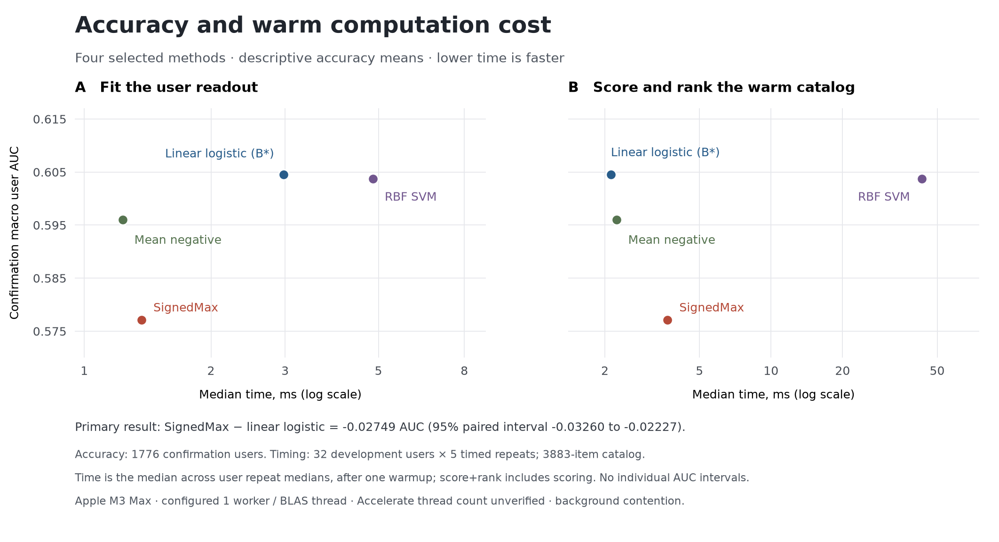

# Signed multi-interest recommendation

**A recommendation approach that keeps multiple interests and uses explicit dislikes.**

People can have several unrelated interests. **SignedMax** keeps those interests
separate, scores a candidate by its strongest match to any of them, and subtracts
a penalty for resembling something the user disliked.

The method works on normalized item embeddings. This repository provides the
Python implementation and the experiments to test the idea against established
baselines. **MovieLens 1M is the included benchmark.**

## The idea

```text
score = strongest positive-interest match − λ × strongest negative-example match
```

Positive examples are grouped into several interest prototypes. Negative examples
stay as individual vectors. Matches use cosine similarity; λ controls the penalty.

Use the code to try the rule on your own embeddings and positive/negative
histories, compare it with logistic regression, SVM and geometric baselines, or
inspect the completed experiment. Model selection uses development users; frozen
methods are then evaluated on separate confirmation users.

## Try the scoring rule

From a checkout, with Python 3.11–3.12:

```sh
python3.12 -m venv .venv
. .venv/bin/activate
python -m pip install -e .
```

This tiny example uses synthetic unit vectors: two different interests and one
negative example.

```python
import numpy as np
from signed_study.models import signed_scores

items = np.eye(3, dtype=np.float64)
interests = items[:2]
dislikes = items[2:]

scores = signed_scores(items, interests, dislikes, penalty=1.0)
print(scores.tolist())  # [1.0, 1.0, -1.0]
```

Both interests get a match. The negative example gets penalized.
[Setup, tests and benchmark reproduction](REPRODUCE.md). The MovieLens benchmark
acquires its dataset and encoder weights separately.

For repeated catalog queries, an optional cache reuses item similarities. Strict
mode preserves the original rankings; opt-in fast mode can reorder near ties.
[Benchmarks, memory costs and API](docs/research/retrieval.md).

## What the experiment found

**Logistic regression beat SignedMax.** The MovieLens 1M experiment compared
**83 configurations on development users**, then evaluated **13 frozen methods
on all 1,776 confirmation users**.

| Method | AUC, higher is better |
| --- | ---: |
| SignedMax | 0.5771 |
| Logistic regression | **0.6046** |

SignedMax minus logistic was **−0.0275 AUC**, with a paired 95% interval of
**[−0.0326, −0.0223]**. This evaluation doesn't establish a recommendation-quality
gain for the proposed approach. [Full findings and limitations](docs/study-outcome.md).



The recorded CPU timings exclude shared encoding; Accelerate's actual thread
count wasn't independently verified. Faster scoring doesn't establish better
recommendations.

Check the published aggregates with Python 3.11+, without installing dependencies:

```sh
python3 scripts/verify_public_results.py
```

By **Artem Legotin**. **AGPL-3.0-only** software; **CC BY 4.0** writing and
figures. [Licensing](LICENSING.md) · [Upstream notices](THIRD_PARTY_NOTICES.md) ·
[Citation](CITATION.cff). Development used AI assistance; README editing used
[write-like-me](https://github.com/arlegotin/write-like-me).
