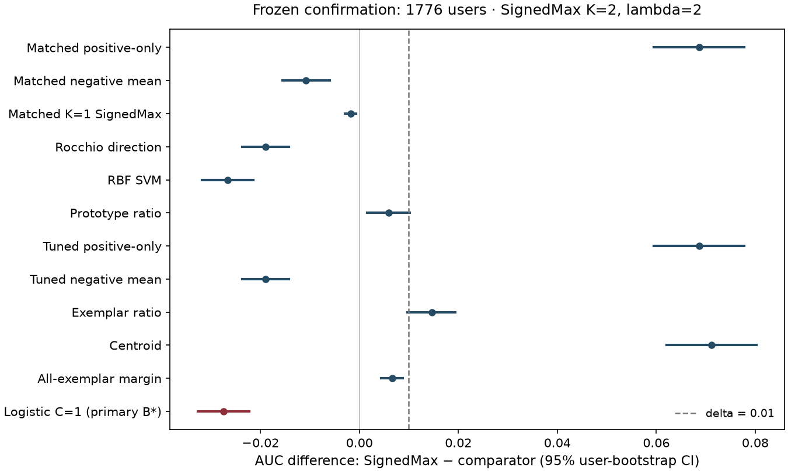

# Native study outcome: informative negative

**SignedMax underperformed the frozen strongest development comparator.** On all
1776 confirmation users, SignedMax (K=2, lambda=2) achieved macro user AUC
**0.577081**, versus **0.604572** for frozen B*, linear logistic regression
(C=1). The paired difference was **−0.027491**, with a **95% user-bootstrap
interval [−0.032603, −0.022267]**. Its upper bound is below both zero and the
unchanged practical threshold delta=0.01. This rules out the specified useful
advantage and establishes lower AUC within this study's scope. It is an
informative negative result, with complete scheduled observations.

The question was whether a nearest-negative penalty improves a small
multi-interest readout of frozen content vectors. Negative feedback helped the
positive-only ranker, but nearest-negative aggregation did not beat a negative
mean or the trained linear readout. The matched K=1 readout also had slightly
higher confirmation AUC than selected K=2. These component comparisons are
secondary and unadjusted; the primary conclusion uses only the preselected B*.

The fixed experiment used official MovieLens 1M, title/year/genre text and
`sentence-transformers/all-MiniLM-L6-v2` revision
`1110a243fdf4706b3f48f1d95db1a4f5529b4d41` on CPU. Among 6040 users, 2194 met the
original temporal eligibility rules: 418 development and 1776 confirmation.
Earlier ratings >=4 and <=2 supplied capped histories of at most 128 positive
and 64 negative items. Evaluation used every later explicitly rated extreme
item, with equal user weight. This is conditional observed-rating prediction,
not an exposure-corrected catalog or online satisfaction experiment.

Development evaluated all 78 initial configurations and five prespecified RBF
lower-g endpoints (g=0.0625 across the original C grid), for 83 configurations
on all 418 users. A 32-user timing-only endpoint pilot added 160 counted
evaluations. S* was K=2/lambda=2, development AUC 0.582717; B* was logistic C=1,
AUC 0.600585. MeanNegative selected K=1/lambda=2 (0.598971); RBF selected C=1,
g=0.25 (0.599581). Every configuration completed, no prototype hit its update
cap, and no numerical repair was requested. All endpoints were admitted and no
persistent outer winner remained. Complete-suite tuning coverage was eligible;
this does not establish superiority over the suite or over unrestricted tuning.
The optimistic development-based planned half-width was 0.005434.

The clean committed source, current full G1 proof, exact cohort identities,
metric, settings, full 13-slot schedule and immutable lock were verified before
the first confirmation outcome access. All **23088 confirmation evaluations**
completed: 13 methods/controls for each of 1776 users, with zero failures,
missing results or post-exposure corrections. B* was never reselected.
Intervals below use the unchanged 10000 paired user-bootstrap resamples,
seed 20261029 and batch size 200. Differences are SignedMax minus the comparator.

| Frozen method/control | Macro AUC | Paired difference | 95% interval |
| --- | ---: | ---: | --- |
| SignedMax, K=2/lambda=2 | 0.577081 | — | — |
| **LinearLogistic, C=1; primary B*** | **0.604572** | **−0.027491** | **[−0.032603, −0.022267]** |
| RBFSVM, C=1/g=0.25 | 0.603734 | −0.026652 | [−0.031780, −0.021467] |
| MeanNegative, K=1/lambda=2 | 0.596051 | −0.018970 | [−0.023645, −0.014292] |
| RocchioDirection, K=1/lambda=2 | 0.596051 | −0.018970 | [−0.023645, −0.014292] |
| Matched MeanNegative, K=2/lambda=2 | 0.587876 | −0.010794 | [−0.015519, −0.006011] |
| Matched K=1 SignedMax, lambda=2 | 0.578872 | −0.001790 | [−0.002938, −0.000616] |
| AllExemplarMargin, lambda=4 | 0.570494 | +0.006588 | [+0.004440, +0.008720] |
| PrototypeRatio, K=1 | 0.571143 | +0.005938 | [+0.001549, +0.010155] |
| ExemplarRatio | 0.562448 | +0.014633 | [+0.009699, +0.019415] |
| PositiveMax, K=2 | 0.508413 | +0.068669 | [+0.059457, +0.077766] |
| Matched PositiveMax, K=2 | 0.508413 | +0.068669 | [+0.059457, +0.077766] |
| Centroid | 0.505895 | +0.071186 | [+0.062051, +0.080236] |



The [aggregate metrics CSV](native-confirmation-metrics.csv) and
[full-precision paired comparisons](native-confirmation-comparisons.csv) retain the
numerical exports. The metrics CSV also contains
NDCG@10, negative-at-10 and exact tie fractions. SignedMax's NDCG@10 was 0.745850
versus logistic's 0.755282; negative-at-10 was 0.275450 versus 0.262218.
These are descriptive secondary means, with no invented intervals. Rocchio and
MeanNegative share the selected K=1 configuration; selected and matched
positive-only methods share K=2. These repeated slots are controls, not extra
independent users.

The matched mean control changes negative aggregation and user-specific penalty
scale together: a raw negative mean has varying norm. Its negative result does
not uniquely isolate candidate-dependent geometry as a causal mechanism.
Selecting K>1 and lambda>0 on development does not independently prove either
component contributes. The K=1 comparison favors K=1 by a small difference;
its entire interval lies within ±0.01. No practical multiple-interest advantage
was established. The positive-only comparison supports using negative feedback
in this setting, with the secondary-analysis qualification.

Frozen mechanism diagnostics used development-frozen median thresholds for
history heterogeneity (H) and positive/negative overlap (O). In the high-H/high-O group
(n=365), SignedMax minus matched MeanNegative was −0.015297, interval
[−0.023451, −0.007255]. This subgroup result is secondary and unadjusted, not a
new primary target. Negative-mean norms ranged 0.647878–0.851238; their descriptive
correlation with the matched AUC difference was 0.006008. This does not remove
the scale-confounding limitation. All 704 float32 checks of frozen geometry
completed: maximum score perturbation 3.223274e-6, four changed rank positions,
and **zero AUC changes**. Canonical accuracy remains float64. Conditional
contamination was **inapplicable under the frozen rule**, with no trigger;
it was not omitted because of elapsed time.

Timing used the fixed full 3883-item catalog, 32 prespecified development users,
one warmup and five timed repetitions per method. All 2496 evaluations completed
without failure; medians below are medians across each user's repeat median.
Score+rank includes scoring. Repetitions are performance measurements, not
accuracy seeds or additional users.

| Method | Fit, ms | Catalog score, ms | Score+rank, ms | Whole evaluation, ms |
| --- | ---: | ---: | ---: | ---: |
| SignedMax | 1.369 | 3.266 | 3.670 | 6.836 |
| MeanNegative | 1.233 | 1.854 | 2.237 | 5.255 |
| LinearLogistic | 2.976 | 1.726 | 2.120 | 6.831 |
| RBFSVM | 4.852 | 42.700 | 43.139 | 51.442 |
| PrototypeRatio | 1.264 | 13.497 | 13.902 | 16.679 |

These are computational measurements on this catalog and workload sample.
The saved inspection identifies Apple M3 Max, arm64, 36 GiB RAM, 14 logical
CPUs and Python 3.12.9. A separate snapshot immediately before G5 recorded
AC power, battery 100%, `pmset` power mode 0, no recorded thermal/performance
warning, 12.6% global CPU activity over one second and load averages
3.39/4.14/4.16. It is a point-in-time observation with background contention.
The configured policy was one worker and one BLAS thread; G5 detected libomp
with one thread. NumPy uses Accelerate, whose actual thread count was not
independently verified; thread-control environment variables were unset.
Timing therefore carries that qualification, with no claim of independently
verified BLAS single threading or extrapolation beyond this catalog.

On 31 October, after the original G2 forecast stop and before full development,
freeze or confirmation, the user authorized `results_first`: elapsed totals,
allocations, forecasts, reporting reserve and the ordinary material-repair quota
became advisory. Scientific settings, numerical iteration rules, thresholds,
seeds, models, data, holdout, evaluation bound and non-time resource constraints
were preserved. Full cohorts were used by the original digest order. The
original stop remains historical in the hash-indexed 20-file archive; original
G0/G1/G2 publications were not moved or overwritten. Saved calibration was
verified and adopted with **zero new fits/encoding/evaluations**, retaining its
1056 evaluations and the original failed forecast-owning attempt.

| Actual counted work | Evaluations |
| --- | ---: |
| Original calibration, reused once | 1056 |
| Smoke, 8 users ×78 entries | 624 |
| Development, including 160 timing-only pilot fits | 34854 |
| Frozen confirmation | 23088 |
| Numerical/timing diagnostics, warmups included | 3200 |
| **Total** | **62822 / 100000** |

The initial development grid took **2711.963s**, partitioned as fit 78.695s,
score+metrics 24.312s, measured journal writes 9.004s, broader pipeline overhead
2577.544s and remaining boundary/finalization 22.408s. That broader boundary
includes accumulating evidence serialization/publication, resource checks and
other pipeline work; it does not isolate physical I/O. Endpoint profiling took
7.177s, full endpoint-campaign pricing 375.467s, the full endpoint grid 243.846s
and final selection/readiness/serialization 82.257s. Ten development admissions
summed to 3442.591s, before separately recorded between-admission overhead.
The advisory full-cohort G3 forecast was 83643.394s for the bounded maximum
schedule; the measured campaign used 83 configurations plus its pilot. This
upper-envelope forecast is not measured model runtime. The historical overhead
forecast did not demonstrate method infeasibility, and the actual growing
publication costs were substantial even though fitting/scoring were small.

At the bound native-summary snapshot, cumulative stage accounting was G0
267.495s, G1 4785.443s, G2 114.982s, G3 3536.153s, G4 804.143s, G5 154.138s,
G6 262.320s and repair 44.826s; setup was a separate 77.583s. These retain all
historical failures, tests, repairs and archival work. Reporting extends the
ledger, so later G6 snapshots differ. The confirmation-owning admission took
788.416s; the base diagnostic admission took 110.653s. An additional metadata
helper audit failed once on dictionary-only hashing after successful lock
verification; its 7.581s failure and corrected 7.705s audit remain recorded,
with zero model evaluations and no experimental-source change.

During native continuation, peak sampled process-tree RSS was 3407511552 bytes
(3.408 GB), OS maximum RSS 3432333312 bytes (3.432 GB), minimum available memory
6546178048 bytes, maximum project size 5217968826 bytes and minimum free disk
46366121984 bytes. GB here is decimal; the saved hardware's 36 GiB is binary.
Recorded native memory/disk/evaluation guards passed. No paid or remote compute was used.

| Provenance anchor | SHA256 / commit |
| --- | --- |
| Frozen scientific source | `5a0595d29869678c9b424ae0a9df42bfcee7f8f9` |
| Immutable protocol lock | `7e13cb9bfbb6ddbaa27aa9d39c6291304f3120c74a107ce5eccdf1cb75902eca` |
| Current full G1 proof, 462 tests in 313.12s | `0e260a5cbbaed5841a4c912624bf32c29f380d12cdcc07dff731397bc5d14eee` |
| Original resource identity | `83fa9e4af5bf1e1fe196e1d8b820286416b9feb03f48164a7970633423ad5e0b` |
| Native aggregate summary | `ee34a77e466e2151f1a1686a648516ad6c1cd1143b75a0cd828da6bf73a1b01d` |
| Original stop archive index | `538551412e4937f062e3a5d5ab2cdb7638feedd34a91eeea93c7824e254babfc` |

`results/report.md`, `comparisons.csv`, `metrics.csv`, `actual-work.csv`, paired
figures and `artifact-inventory.json` are generated from saved evidence. The
bound aggregate audit is `results/operator_logs/task2-scientific-summary.json`.
The generic renderer flags the inspection's external binding because it compares
absolute and relative path spellings. The tracked packaging script resolves this
qualification in the active report after independently verifying the same resolved
file and exact SHA
`e5efe69820351624ac9e66a6d5ec974c853d8e94cb7060e676ee392563f9abba`
against completed G0 publication `d63a7e4b-9881-43d5-ae91-31be97ecaacc`.
Hardware values remain historical inspection evidence, supplemented by the
fresh operating-conditions snapshot; this reporting caveat does not change
frozen accuracy provenance.

From the repository root, regenerate the active scientific exports with:

```sh
.venv/bin/python -m signed_study report --results results
.venv/bin/python scripts/render_results_first_study.py --results results
```

Do not run the original `scripts/render_study_outcome.py` G2-only wrapper against
this final result. Local raw data, vectors, outcomes, scores and complete result
bundles remain ignored; tracked exports contain aggregate findings only. Preserve
bound publications, lock/sidecar and exposure journal at their recorded paths.
The tracked script verifies the bound native summary against current saved
publications, regenerates the committed aggregate CSVs/figure, adds operational
qualifications to the active report and writes a versioned reproduction receipt
selected by `results/results-first-reproduction.json`. Repeated packaging checks
exact scientific CSV/PNG hashes while allowing cost snapshots to advance. It uses
no workflow scratch files, fitting, encoding, outcome-array access or bootstrap rerun. The [decision history](study-decisions.md) retains
the earlier stop, amendments and their risks. This result does not establish
online utility, universal embedding failure or a first-ever contribution.
